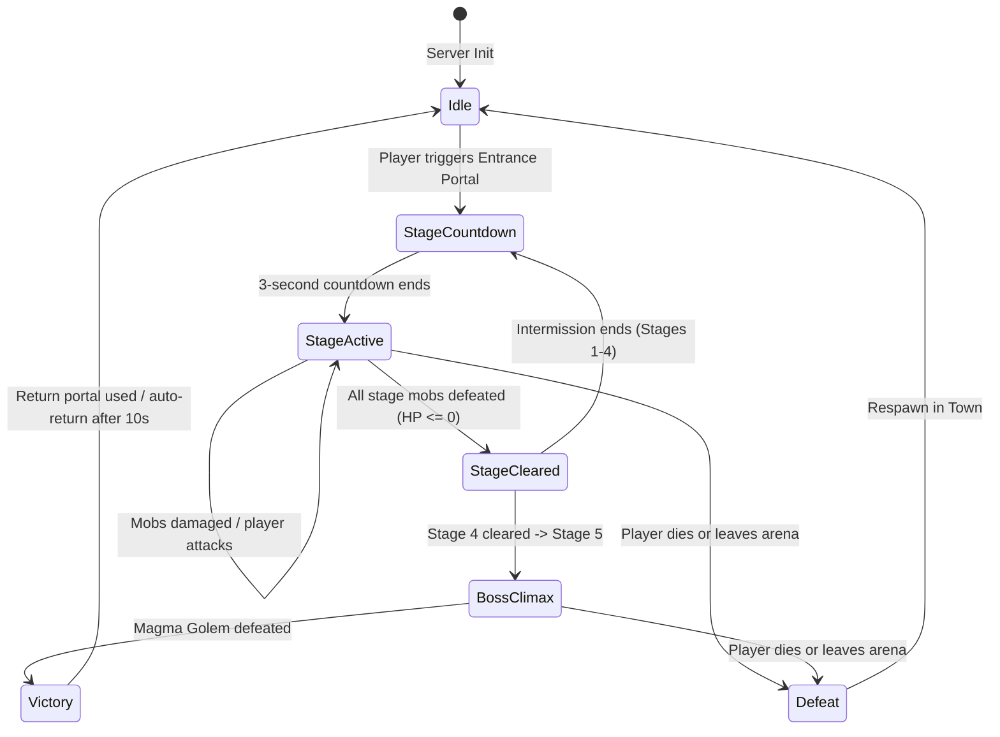

# Design Specification: Stage-Based Dungeon Tower (Stages 1–5)

## 1. Overview & Objective
This specification defines the architecture, components, and gameplay mechanics for the **Stage-Based Dungeon Tower** in the Roblox Tycoon Simulator. Players enter an ancient trial spire via a runic portal at the Town Ruins, battling through 5 progressive stages of increasingly formidable mobs, culminating in an encounter with the **Infernal Magma Golem** on Stage 5.

---

## 2. World Integration & Chamber Layout

### 2.1 Town Entrance (Dungeon Ruins)
- **Location**: Positioned at the ancient ruins framing the Meadow southwest edge (`Vector3.new(-92, 0, -92)`).
- **Structure**:
  - Twin ancient ruined columns flanking an elevated stone dais.
  - An ancient Runestone Portal with swirling purple and cyan particle emitters (`ParticleEmitter`), glowing glyphs, and point lights.
  - `ProximityPrompt`:
    - `ActionText`: `"Enter Dungeon Tower"`
    - `ObjectText`: `"Ancient Trial Spire (Stages 1-5)"`
    - `KeyboardKeyCode`: `Enum.KeyCode.E`
    - `MaxActivationDistance`: 14 studs

### 2.2 The Dungeon Tower Arena
- **Location**: `Vector3.new(300, 20, 0)` in a dedicated void sector isolated from the main tycoon town.
- **Components**:
  - **Arena Platform**: 80×80 stud circular stone plinth constructed from ashlar stone, cobblestone trim, and embedded purple runic inlays.
  - **Perimeter Columns & Braziers**: 8 perimeter pillars with flaming iron braziers casting warm amber light across the arena.
  - **Spawn Points**:
    - Player Entry Dais at the southern perimeter (`Vector3.new(300, 21, 32)`).
    - Mob Spawn Arc at the northern perimeter (`Vector3.new(300, 21, -25)`).
    - Boss Spawn Center at `Vector3.new(300, 21, 0)`.
  - **Exit Portal**: Runic return arch at the arena edge enabling voluntary retreat or exit after victory.

---

## 3. Stage Progression & Scaling Specification

### 3.1 Stage Breakdown
| Stage | Enemies | Count | Health (per mob) | Base Damage | Speed | Theme & Visuals |
| :--- | :--- | :---: | :---: | :---: | :---: | :--- |
| **1** | Cave Imps | 3 | 1,000 HP | 8 DMG | 12 | Mossy green stone cubes, glowing lime stud eyes, wooden club arms |
| **2** | Ruin Skeletons | 4 | 2,800 HP | 14 DMG | 14 | Bleached ashlar bone studs, rusty iron spikes, medium speed |
| **3** | Obsidian Golemites | 4 | 6,500 HP | 20 DMG | 16 | Dark basalt rock blocks, glowing cyan runes, rock fling attack |
| **4** | Magma Brutes | 3 | 14,000 HP | 28 DMG | 13 | Fiery lava cracks, ground-pound shockwave, heavy hitboxes |
| **5** | Infernal Magma Golem | 1 | 35,000 HP | 35 DMG | 10 | World Boss (Tower Climax Edition): Molten fists, chest fire core, lava stomp |

### 3.2 Total Health & Scaling Curves
- Total Enemy HP per Stage:
  - Stage 1: 3,000 HP
  - Stage 2: 11,200 HP
  - Stage 3: 26,000 HP
  - Stage 4: 42,000 HP
  - Stage 5: 35,000 HP (Single Boss with enhanced mechanics)

---

## 4. Combat Mechanics & Systems Integration

### 4.1 Player Offense
- Players attack mobs using their equipped pickaxe (`PickaxeService`).
- Swings trigger hit-detection against active dungeon mobs within a 9-stud frontal radius.
- Damage formula inherits:
  - `BasePickaxeDamage` × `RebirthMultiplier` × `PetMultiplier` × `PickaxeBossMultiplier`.
  - Pickaxe Traits apply: *GoldRush* (bonus cash per hit), *Stun* (chance to freeze mobs for 0.8s), *MoltenBurn* (burn ticks).
- Damage events fire client visual indicators (floating damage numbers with crit styling).

### 4.2 Mob Behavior & AI
- Simple state-driven pursuit:
  - Finds nearest player in the arena within 100 studs.
  - Moves toward player target via Humanoid:MoveTo / CFrame pathing.
  - When within contact distance (6 studs) and attack cooldown is ready (1.5s), performs an attack swing and applies damage to player Humanoid.
- When mob health reaches 0:
  - Plays death shatter effect with stone particle fragments.
  - Awards mob bounty and checks remaining stage count.

---

## 5. State Machine & Flow (`DungeonService.luau`)

### 5.1 Stage Rewards
- **Stage 1**: +$15,000 Cash, +50 Gems
- **Stage 2**: +$35,000 Cash, +120 Gems
- **Stage 3**: +$75,000 Cash, +250 Gems, +1 Wood Crate
- **Stage 4**: +$150,000 Cash, +500 Gems, +1 Iron Crate
- **Stage 5 (Jackpot Climax)**: +$500,000 Cash, +2,000 Gems, +1 Gold Crate, +500 Boss Slayer Mastery XP

---

## 6. Client Experience & UI (`DungeonClient.luau`)

### 6.1 HUD Overlay
- **Top Center Card**:
  - `🏰 DUNGEON TOWER • STAGE [X] / 5`
  - `💀 Enemies Left: [N]` (switches to animated Boss Health Bar on Stage 5)
  - Next stage countdown timer during intermission
- **Exit Button**: `🚪 Leave Tower` button on top right to safely retreat to town anytime.

### 6.2 Visual & Audio FX
- Countdown chimes on stage start.
- Floating popups for stage clears: `🎉 STAGE [X] CLEARED! +$Cash +💎Gems`.
- Stage 5 dramatic entrance: screen rumble, fiery smoke burst, and boss roar.
- Victory fanfare with confetti burst upon Stage 5 completion.

---

## 7. Architecture & Files Touched

1. **`src/shared/Config/DungeonConfig.luau`** [NEW]:
   - Defines stages, mob statistics, health, damage, visual colors, and reward tables.
2. **`src/server/Services/DungeonService.luau`** [NEW]:
   - Manages arena construction, player teleportation, wave state machine, mob spawning, aggro, hit registration, and reward grants via `DataService`.
3. **`src/client/Controllers/DungeonClient.luau`** [NEW]:
   - Manages dungeon HUD, stage countdowns, mob remaining counters, boss health bar, exit prompts, and victory animations.
4. **`src/server/Services/MapService.luau`** [MODIFIED]:
   - Builds the entrance portal at `DungeonRuins` and invokes arena generation.
5. **`src/client/init.client.luau`** & **`src/server/init.server.luau`** [MODIFIED]:
   - Initializes `DungeonService` and `DungeonClient`.
