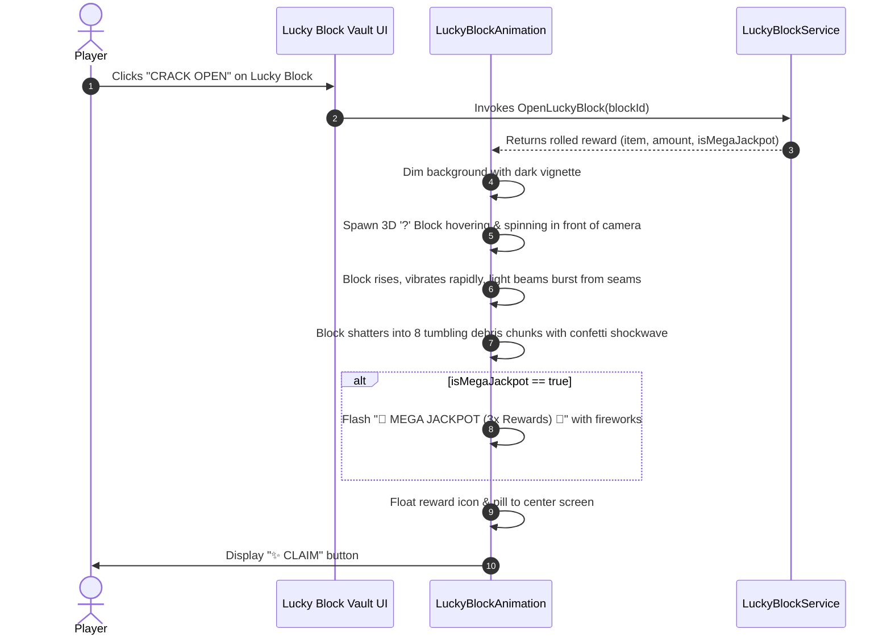

# Design Specification: Lucky Block Subsystem

## 1. Overview & Goal
This specification defines the complete transformation of the legacy Crate / LootBox system into a modern **Lucky Block Subsystem** in Roblox Tycoon Simulator. The new system features:
1. **Physical In-World Quarry Spawns**: Rare Lucky Blocks periodically spawn in the mining quarry for players to discover and mine directly with their pickaxe.
2. **Inventory Vault & UI**: Players can collect, store, and crack open tiered Lucky Blocks from the menu (`❓ LUCKY BLOCKS`).
3. **3D Block Shatter Cutscene**: Replaces the old wooden chest opening with a 3D question-mark cube that hovers, vibrates, cracks with radiant light beams, and explodes into tumbling fragments.
4. **Mega Jackpots**: A 10% chance on any block opening to trigger a **3x Mega Jackpot** with golden fireworks and fanfare.
5. **Seamless Data Migration**: Full backward compatibility ensuring existing player crate inventories are preserved.

---

## 2. Lucky Block Tiers & Visual Identity

### 2.1 Tier Definitions
| Tier ID | Display Name | Visual Style | Particle FX | Base Payout (Cash / Gems) |
| :--- | :--- | :--- | :--- | :--- |
| `block_wood` | Wooden Lucky Block | Warm Oak (`#965F32`) with yellow `?` | Wood chips | $10k–$25k • 30–80 💎 |
| `block_iron` | Iron Lucky Block | Steel grey (`#B4B9BE`) with cyan `?` | Sparkles | $50k–$120k • 150–350 💎 |
| `block_gold` | Golden Lucky Block | Radiant Gold (`#FFD700`) with white `?` | Golden dust & flares | $250k–$600k • 800–2,000 💎 |
| `block_diamond` | Diamond Lucky Block | Crystalline cyan (`#00E5FF`) with glow `?` | Diamond glints | $1.2M–$3.5M • 4,000–10,000 💎 |
| `block_cosmic` | Rainbow Lucky Block | Shifting HSL chromatic rainbow | Twinkling stars & trails | $10M–$25M • 25,000–60,000 💎 |

### 2.2 3D Model Construction
- 4×4×4 stud primary cube with tactile studs on all faces (`Enum.SurfaceType.Studs`).
- Every side face + top face displays an iconic bold question mark (`?`) using high-contrast SurfaceGuis with dark outline dropshadows.
- Glowing PointLight matching the tier color.

---

## 3. Physical Quarry Spawning & In-World Mining

### 3.1 Spawn Lifecycle (`LuckyBlockService.luau`)
- Every 75–120 seconds, a physical Lucky Block spawns at random coordinates in the active quarry terrain (`TrainingQuarry` or main quarry zones).
- Spawns with an upward beacon beam and a slowly rotating gold `?` icon floating 8 studs above the block.
- Remains active for 180 seconds or until mined.

### 3.2 Mining & Breaking
- Has 3 hit points (takes 3 pickaxe strikes to break).
- On each pickaxe hit:
  - Wobbles with a bouncy spring tween.
  - Plays a cracking chime sound.
  - Sheds colorful block chips.
- On the 3rd hit (break):
  - Shatters into 8 physics debris fragments that fly outwards.
  - Bursts with star particles and a confetti pop.
  - Drops instant Cash & Gems floating pickups directly to the player, plus adds a free Lucky Block item to their inventory!

---

## 4. Client 3D Opening Cutscene (`LuckyBlockAnimation.luau`)

### 4.1 Animation Sequence

---

## 5. UI Integration & Dock Modernization

1. **Left Side Dock Menu**:
   - Replaces the old `📦 CRATES` button with a vibrant amber stud button: **`❓ LUCKY BLOCKS`**.
   - Displays live inventory count badge.
2. **Lucky Block Vault Modal**:
   - Window Title: `❓ LUCKY BLOCK VAULT`.
   - Displays all 5 tiers with interactive 3D preview cards, current quantity owned, and `CRACK OPEN` / `CRACK 5X` action buttons.
3. **Cross-System Wiring**:
   - Quests, Codes, Dungeon Tower, and Daily Rewards now reward Lucky Blocks with matching icons.

---

## 6. Architecture & Files Touched

1. **`src/shared/Config/LuckyBlockConfig.luau`** [NEW]:
   - Supersedes `LootBoxConfig.luau`.
   - Defines all 5 Lucky Block tiers, drop tables, jackpot multipliers, and backward aliases for `crate_*` IDs.
2. **`src/server/Services/LuckyBlockService.luau`** [NEW]:
   - Supersedes `LootBoxService.luau`.
   - Manages physical quarry block spawning, pickaxe hit registration, block breaking, and server opening validation.
3. **`src/client/Controllers/LuckyBlockAnimation.luau`** [NEW]:
   - Supersedes `LootBoxAnimation.luau`.
   - Implements the 3D block hovering, shaking, seam-light bursting, and shattering sequence with jackpot celebration.
4. **`src/server/Services/DataService.luau`** [MODIFIED]:
   - Supports both `data.LuckyBlocks` and `data.LootBoxes` seamlessly with automatic bi-directional alias lookup.
5. **`src/client/Controllers/UIController.luau`** [MODIFIED]:
   - Updates left dock button to `❓ LUCKY BLOCKS` and restyles modal to the Lucky Block Vault.
6. **`src/server/init.server.luau`** & **`src/client/init.client.luau`** [MODIFIED]:
   - Replaces `LootBoxService` with `LuckyBlockService`, and `LootBoxAnimation` with `LuckyBlockAnimation`.
